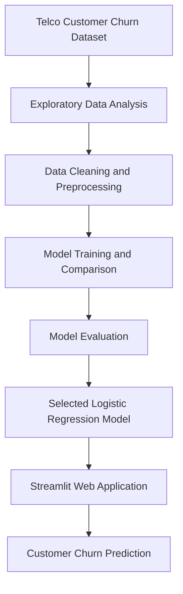
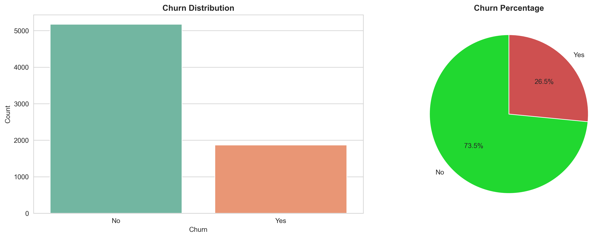
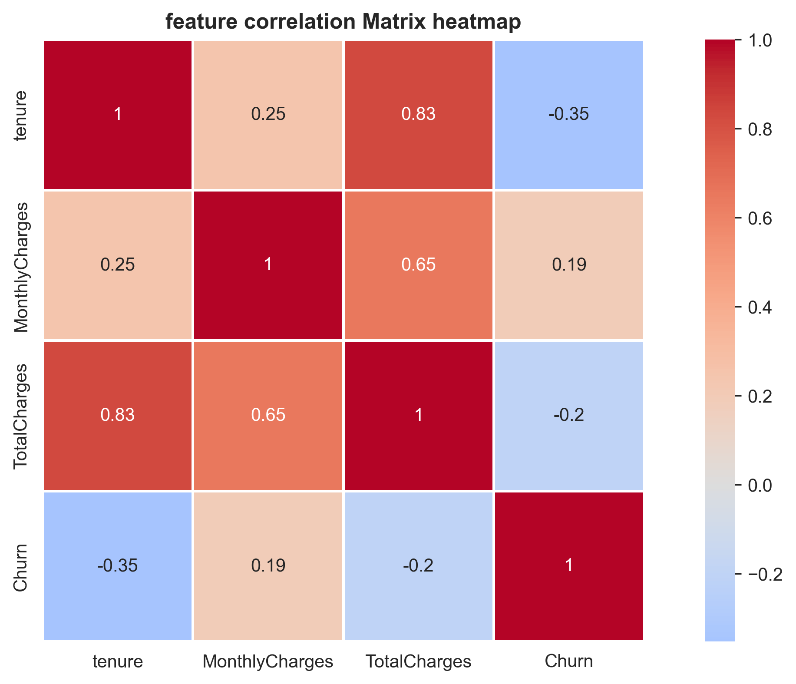
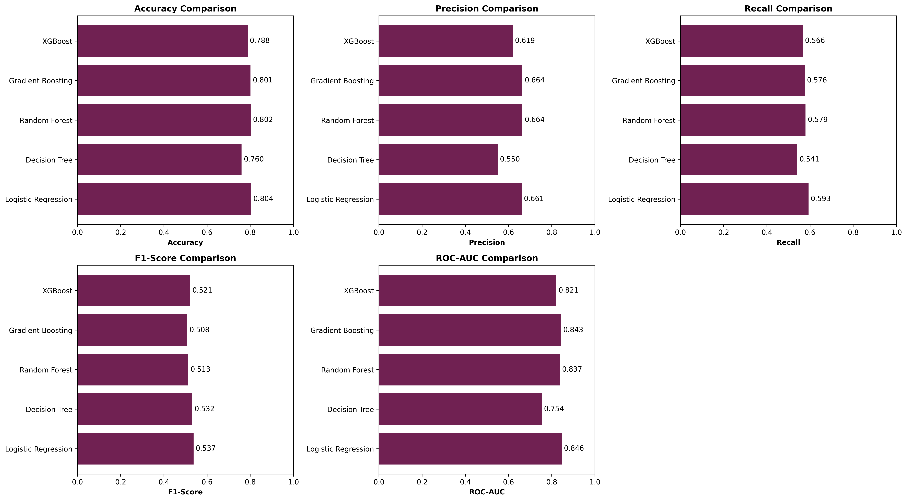
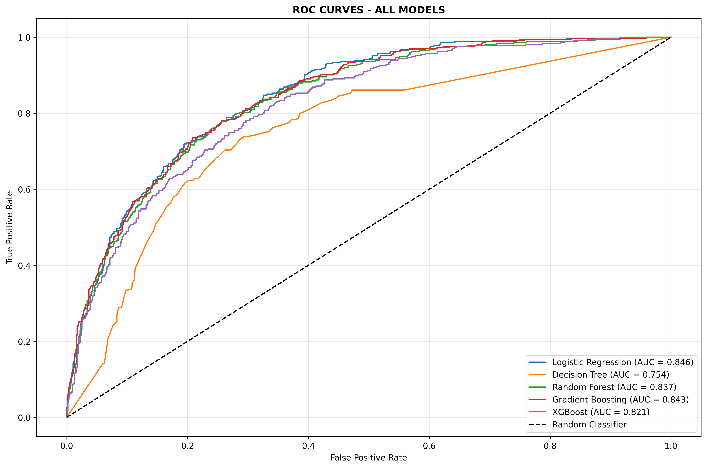
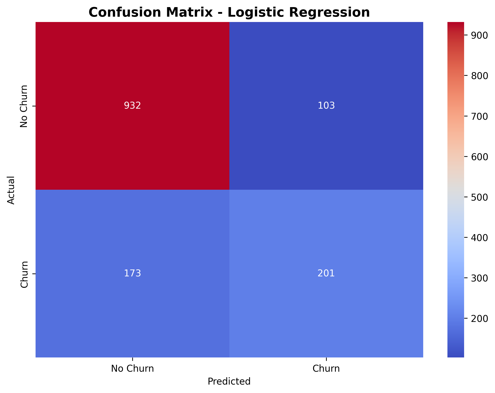
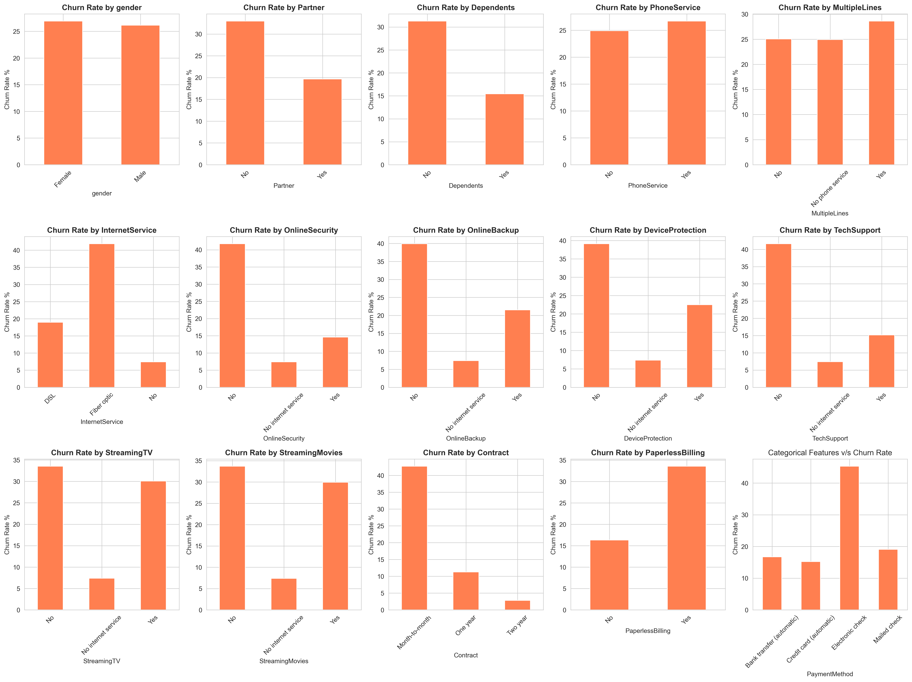
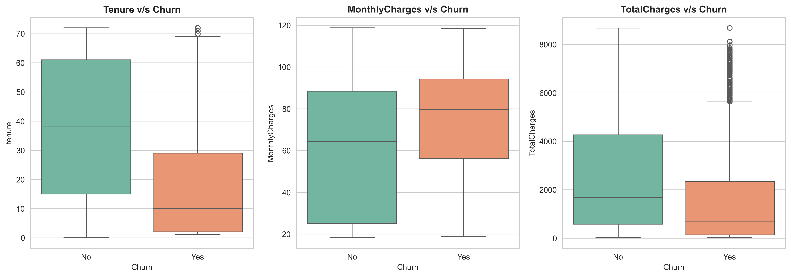

# 📉 Telco Customer Churn Prediction

**An end-to-end machine learning project to predict customer churn in the telecommunications industry, featuring exploratory data analysis, model comparison, and an interactive Streamlit application.**

<p align="center">
  
  
  
  
</p>

<p align="center">
  <a href="https://github.com/RohitSinghChaudhary/churn_prediction_project">
    
  </a>
  <a href="https://www.kaggle.com/datasets/blastchar/telco-customer-churn">
    
  </a>
  
</p>

---

## 📖 Project Overview

Customer churn occurs when customers stop using a company's products or services. Predicting which customers are likely to leave can help businesses understand customer behavior and develop better retention strategies.

This project implements an end-to-end machine learning workflow, covering data exploration, preprocessing, model training and comparison, evaluation, and interactive churn prediction using Streamlit.

## ✨ Key Features

- 🔍 **Exploratory Data Analysis:** Explore customer demographics, services, contracts, and billing patterns.
- 🧹 **Data Preprocessing:** Prepare data for machine learning.
- 🤖 **Model Comparison:** Compare trained classification models.
- 📈 **Churn Prediction:** Use the selected Logistic Regression model to predict customer churn.
- 📊 **Model Evaluation:** Review classification results, confusion matrix, and ROC curves.
- 🌐 **Interactive Web App:** Enter customer information and obtain a prediction through Streamlit.
- 💾 **Saved Model Artifacts:** Load the trained model and preprocessing pipeline for predictions.

## 🧰 Tech Stack

| Category | Technologies |
| :-- | :-- |
| **Language** |  |
| **Data Processing** |   |
| **Machine Learning** |  |
| **Visualization** |   |
| **Web Application** |  |
| **Development** |  |
| **Model Persistence** |  |

## 💾 Dataset

**Source:** [Telco Customer Churn Dataset — Kaggle](https://www.kaggle.com/datasets/blastchar/telco-customer-churn)

The dataset contains customer information, subscribed services, contract details, payment methods, billing information, and churn labels.

It is used to explore factors associated with churn and train machine learning models to predict whether a customer may leave.

## 📂 Project Structure

```text
churn_prediction_project/
├── app.py
├── data/
│   └── telco_comm_churn.csv
├── models/
│   ├── best_model_logistic_regression.pkl
│   └── preprocessor.pkl
├── notebooks/
│   ├── 01_eda.ipynb
│   ├── 02_data_preprocessing.ipynb
│   └── 03_model_training.ipynb
├── other/
│   └── test.py
├── reports/
│   ├── categorical_analysis.png
│   ├── churn_distribution.png
│   ├── confusion_matrix.png
│   ├── correlation_heatmap.png
│   ├── model_comparison.csv
│   ├── model_comparison_graph.png
│   ├── numerical_analysis.png
│   └── roc_curves.png
├── src/
│   └── data_preprocessing.py
├── requirements.txt
├── .gitignore
└── README.md
```

## 🚀 Getting Started

Follow these steps to run the project on your computer.

### Prerequisites

- Python installed on your system
- Git installed on your system
- pip package manager

### 1. Clone the repository

```bash
git clone https://github.com/RohitSinghChaudhary/churn_prediction_project.git
cd churn_prediction_project
```

### 2. Create and activate a virtual environment

**Windows — Command Prompt**

```cmd
python -m venv .venv
.venv\Scripts\activate
```

**Windows — Git Bash**

```bash
python -m venv .venv
source .venv/Scripts/activate
```

**macOS / Linux**

```bash
python3 -m venv .venv
source .venv/bin/activate
```

### 3. Install dependencies

```bash
python -m pip install -r requirements.txt
```

### 4. Run the Streamlit application

```bash
streamlit run app.py
```

Open the local URL displayed in your terminal to use the application.

## 🧠 Machine Learning Workflow



### 1. Exploratory Data Analysis

Analyze customer characteristics, feature distributions, and relationships between customer attributes and churn.

### 2. Data Preprocessing

Prepare the dataset for model training using the preprocessing steps implemented in the notebooks and source code.

### 3. Model Training and Comparison

Train and compare classification models. The selected Logistic Regression model and its associated preprocessor are saved in the `models/` directory.

### 4. Model Evaluation

Evaluate the trained models and review the generated reports, including classification visualizations and model comparison results.

See `reports/model_comparison.csv` for the recorded model comparison results.

### 5. Interactive Prediction

The Streamlit application provides an interface for entering customer information and generating churn predictions using the saved model artifacts.

## 📊 Project Visualizations

The following visualizations are generated during the analysis and model evaluation stages.

### Churn Distribution



### Correlation Heatmap



### Model Comparison



### ROC Curves



### Confusion Matrix



### Categorical Feature Analysis



### Numerical Feature Analysis



## 💼 Business Use Case

Customer churn prediction can help telecommunications businesses:

- Identify customers who may be at risk of leaving.
- Understand customer behavior and service usage patterns.
- Prioritize customer retention efforts.
- Support data-driven customer relationship management.

**Note:** Model predictions estimate churn risk and do not guarantee future customer behavior.

## 🔮 Future Improvements

- [ ] Deploy the Streamlit application online.
- [ ] Improve model explainability using feature importance or SHAP.
- [ ] Explore additional hyperparameter-tuning techniques.
- [ ] Develop personalized customer-retention recommendations.
- [ ] Monitor model performance on new customer data.

## 👤 Author

**Rohit Singh Chaudhary**

[](https://github.com/RohitSinghChaudhary)
[](https://www.linkedin.com/in/rohitsinghchaudhary/)
